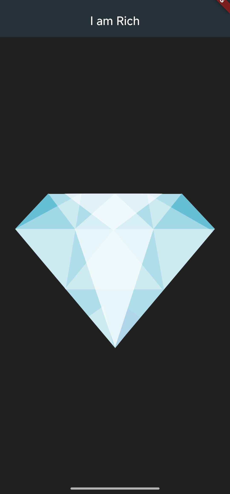

# I Am Rich

A simple parody app built while getting started with Flutter. The app displays a diamond image alongside a minimal interface, using Flutter's Material widgets.

## 🖼️ Preview

<p align="center">
  
</p>

## 🧰 Concepts Practiced

- Basic Flutter application structure using `MaterialApp` and `Scaffold`
- Using `AppBar` and other Material widgets to build an interface
- Widget composition and layout using `Center`
- Displaying local images using `Image` and `AssetImage`
- Registering assets in `pubspec.yaml`

## 🏃‍♂️ How To Run

Clone the repository and navigate to the project directory:

```bash
git clone https://github.com/aruncbhusal/learning-flutter.git
cd learning-flutter/day_2_i_am_rich
```

Install dependencies and run the app:

```bash
flutter pub get
flutter run
```

## 📚 Acknowledgements

Built while following [The Complete Flutter Development Bootcamp with Dart](https://www.udemy.com/course/flutter-bootcamp-with-dart/) by Angela Yu.
