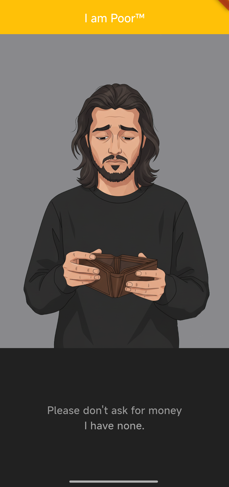

# I Am Poor

An app challenge from the course that demonstrates my poverty. It started as a simple image displayed in a `Scaffold`, which I later extended with a `Column` layout and a couple of messages.

## 🖼️ Preview

<p align="center">
  
</p>

## 🧰 Concepts Practiced

- Building layouts using `Column`, `Center` and `Expanded`
- Displaying local images using `AssetImage`
- Controlling image scaling with `BoxFit`
- Styling widgets using Material colors and `TextStyle`
- Understanding widget composition and layout hierarchy

## ♻️ Reusing This Project

This directory contains the application's Dart source code and required assets. The platform-specific project scaffolding has intentionally been omitted to keep this repository focused on the application itself.

To use this project, create a fresh Flutter application and copy the relevant source files and resources into it.

### 1. Clone the repository

```bash
git clone https://github.com/aruncbhusal/learning-flutter.git
```

### 2. Create a new Flutter project

Navigate to the cloned repository and create a new Flutter application outside it:

```bash
cd learning-flutter
flutter create --project-name i_am_poor ../i_am_poor
```

Use the package name specified by the `name` field in this project's `pubspec.yaml`. This keeps the existing `package:` imports valid without having to rename them manually.

### 3. Copy the source code and assets

Copy the contents of this project's `lib/` directory into the newly created application's `lib/` directory.

Also copy any project-specific resource directories present in this folder, such as:

- `images/`
- `assets/`
- `fonts/`

Keep their directory names and relative paths unchanged, since the application may refer to them through its asset declarations.

The new project's generated `lib/main.dart` will be replaced by this project's entry point. Its platform-specific folders and configuration should otherwise remain intact.

### 4. Merge dependencies and asset declarations

Open this project's `pubspec.yaml` and add the required entries to the corresponding sections of the new application's `pubspec.yaml`.

In particular:

- Add the required packages from `dependencies`.
- Add any required development packages from `dev_dependencies`, if needed.
- Merge the asset and font declarations under `flutter`.

Do not replace the newly generated `pubspec.yaml` wholesale. Retain its project name, Dart SDK constraints, Flutter SDK dependency and other generated configuration.

Do not copy this project's `pubspec.lock`. The new application should resolve its own dependencies.

### 5. Configure and run

Complete any additional setup described in this README, such as API keys, platform permissions or Firebase configuration.

Then navigate to the newly created application and run:

```bash
flutter pub get
flutter run
```

A connected device or configured emulator is required.

**Note:** These project directories are source templates, not standalone Flutter applications. They are intended to be used as a starting point for a new project rather than run directly from this repository.

## 📚 References

- [Flutter UI documentation](https://docs.flutter.dev/ui)
- [Column widget](https://api.flutter.dev/flutter/widgets/Column-class.html)

Built while following [The Complete Flutter Development Bootcamp with Dart](https://www.udemy.com/course/flutter-bootcamp-with-dart/) by Angela Yu.
