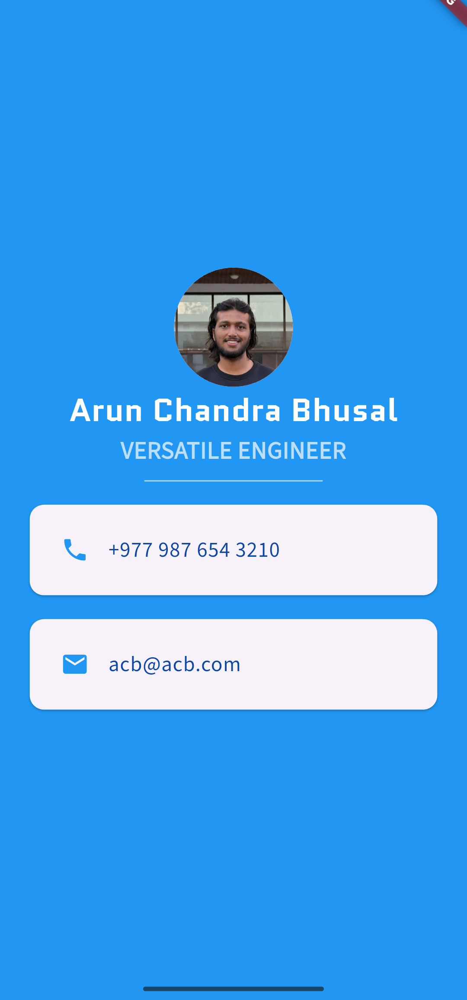

# Mi Card

A digital business card built as an exercise in Flutter UI development. The idea is fairly straightforward: display a profile, a short professional title, and contact details in a single screen.

This project was also where I started getting more comfortable with Flutter's layout system, custom fonts, and Material widgets.

## 🖼️ Preview

<p align="center">
  
</p>

## 🧱 Building the Layout

The app is built around a `StatelessWidget`, with a `Scaffold` and `SafeArea` containing a vertically aligned `Column`.

The layout consists of:

- A `CircleAvatar` displaying a local profile image.
- Text widgets for the name and professional title, styled with custom fonts.
- Two contact cards displaying phone and email details, each with a Material icon.

I initially built the contact sections manually using `Container`, `Row`, `Icon` and `Text` widgets. Later, I switched to `Card` and `ListTile`, which provided a cleaner way to achieve the same layout without manually arranging every element.

The project also includes a `Divider` to separate the profile section from the contact details.

## 🧪 Things I Explored

This wasn't just about putting a few widgets on the screen. Some of the exercises and concepts covered along the way:

- **Container:** Experimenting with dimensions, margins, padding and positioning.
- **Row and Column:** Understanding main-axis and cross-axis alignment, spacing and widget composition. There's also a separate layout challenge preserved as commented code in `main.dart`.
- **CircleAvatar:** Displaying a local image using `foregroundImage`.
- **Text and TextStyle:** Customizing fonts, sizes, colors and weights. Also discovered that `toUpperCase()` saves us from manually typing uppercase text.
- **Custom Fonts:** Registering and using `Quantico` and `Source Sans 3` through `pubspec.yaml`.
- **Material Widgets:** Using `Card`, `ListTile`, `Padding`, `Divider` and Material icons instead of building everything from scratch.

I also got introduced to hot reload and hot restart, and started getting into the habit of referring to Flutter's widget documentation rather than guessing available properties.

> The phone number and email displayed in the app are placeholder values.

## 🏃‍♂️ How To Run

Clone the repository and navigate to the project directory:

```bash
git clone https://github.com/aruncbhusal/learning-flutter.git
cd learning-flutter/day_3_mi_card_flutter
```

Install dependencies and run the app:

```bash
flutter pub get
flutter run
```

## 📚 References & Acknowledgements

- [Container](https://api.flutter.dev/flutter/widgets/Container-class.html)
- [Row and Column](https://api.flutter.dev/flutter/widgets/Column-class.html)
- [CircleAvatar](https://api.flutter.dev/flutter/material/CircleAvatar-class.html)
- [Flutter's Custom Fonts guide](https://docs.flutter.dev/cookbook/design/fonts)

The project was initially cloned from [App Brewery's](https://www.appbrewery.co/) starter repository to obtain the starting structure and assets. The implementation was then modified while following Angela Yu's [The Complete Flutter Development Bootcamp with Dart](https://www.udemy.com/course/flutter-bootcamp-with-dart/).

More detailed learning notes are available in [`notes.md`](../notes.md#day-3).
