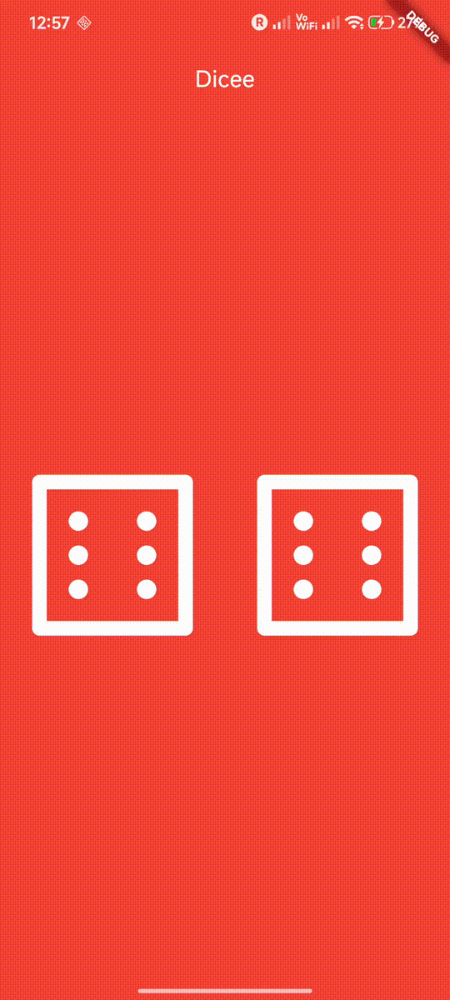

# Dicee 🎲

A simple two-dice rolling app built as an introduction to adding functionality to Flutter applications.

The idea is simple: tap either die and both dice roll. No separate roll button needed. The dice themselves do the job.

## 🖼️ Preview

<p align="center">
  
</p>

## 🎲 How It Works

The app has two dice, each represented by an image asset corresponding to its current value (1–6).

Both dice are initially set to `6`. Tapping either one triggers the same `handleButtonPressed()` function, which generates two independent random numbers and updates their values inside `setState()`.

```dart
void handleButtonPressed() {
  setState(() {
    leftDiceNum = Random().nextInt(6) + 1;
    rightDiceNum = Random().nextInt(6) + 1;
  });
}
```

The image paths are then constructed using string interpolation (`dice$leftDiceNum.png` and `dice$rightDiceNum.png`), so the appropriate dice faces are displayed whenever the state changes.

## 🧩 Layout & Implementation

The main screen is built around a `Row` containing two `TextButton` widgets. Rather than using conventional buttons, the dice images themselves are the clickable elements.

A few things worth noting:

- **StatefulWidget and setState:** The dice values are mutable state, so the page uses a `StatefulWidget`. Calling `setState()` notifies Flutter that the relevant widget subtree needs to be rebuilt.
- **Random number generation:** Dart's `dart:math` library provides `Random().nextInt(6) + 1`, which generates an integer between 1 and 6 (inclusive).
- **Expanded:** Both dice occupy equal portions of the available horizontal space. `Expanded` helps them adapt to the screen width instead of relying on fixed dimensions.
- **Padding:** Adds spacing around each die, keeping the images from sitting directly against the screen edges.
- **Image assets:** The two dice use slightly different constructors: `Image(image: AssetImage(...))` and `Image.asset(...)`. Both load local assets.

This was also my first proper introduction to the difference between `StatelessWidget` and `StatefulWidget`, and how user interactions can trigger UI updates without manually rebuilding the entire application.

## ♻️ Reusing This Project

This directory contains the application's Dart source code and required assets. The platform-specific project scaffolding has intentionally been omitted to keep this repository focused on the application itself.

To use this project, create a fresh Flutter application and copy the relevant source files and resources into it.

### 1. Clone the repository

```bash
git clone https://github.com/aruncbhusal/learning-flutter.git
```

### 2. Create a new Flutter project

Navigate to the cloned repository and create a new Flutter application outside it:

```bash
cd learning-flutter
flutter create --project-name dicee ../dicee
```

Use the package name specified by the `name` field in this project's `pubspec.yaml`. This keeps the existing `package:` imports valid without having to rename them manually.

### 3. Copy the source code and assets

Copy the contents of this project's `lib/` directory into the newly created application's `lib/` directory.

Also copy any project-specific resource directories present in this folder, such as:

- `images/`
- `assets/`
- `fonts/`

Keep their directory names and relative paths unchanged, since the application may refer to them through its asset declarations.

The new project's generated `lib/main.dart` will be replaced by this project's entry point. Its platform-specific folders and configuration should otherwise remain intact.

### 4. Merge dependencies and asset declarations

Open this project's `pubspec.yaml` and add the required entries to the corresponding sections of the new application's `pubspec.yaml`.

In particular:

- Add the required packages from `dependencies`.
- Add any required development packages from `dev_dependencies`, if needed.
- Merge the asset and font declarations under `flutter`.

Do not replace the newly generated `pubspec.yaml` wholesale. Retain its project name, Dart SDK constraints, Flutter SDK dependency and other generated configuration.

Do not copy this project's `pubspec.lock`. The new application should resolve its own dependencies.

### 5. Configure and run

Complete any additional setup described in this README, such as API keys, platform permissions or Firebase configuration.

Then navigate to the newly created application and run:

```bash
flutter pub get
flutter run
```

A connected device or configured emulator is required.

**Note:** These project directories are source templates, not standalone Flutter applications. They are intended to be used as a starting point for a new project rather than run directly from this repository.

## 📚 References & Acknowledgements

- [Dart Math Library](https://api.dart.dev/dart-math/)
- [Expanded widget](https://api.flutter.dev/flutter/widgets/Expanded-class.html)
- [Image widget](https://api.flutter.dev/flutter/widgets/Image-class.html)
- [TextButton](https://api.flutter.dev/flutter/material/TextButton-class.html)

Built while following [The Complete Flutter Development Bootcamp with Dart](https://www.udemy.com/course/flutter-bootcamp-with-dart/) by Angela Yu.

I created a fresh Flutter project for this exercise and copied over the relevant source files and assets, rather than using the original starter project directly, due to SDK/JDK compatibility issues.
