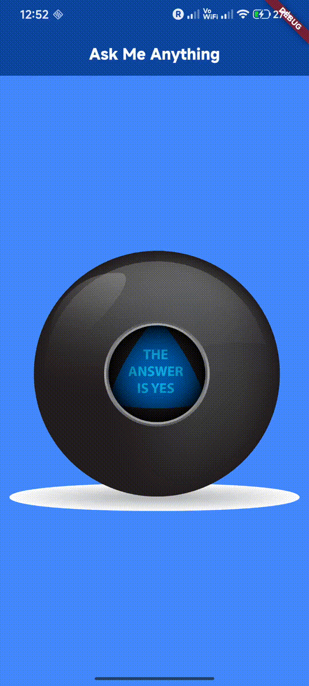

# Magic 8 Ball 🎱

A little fortune-telling app that answers life's difficult questions. Or at least displays one of five predefined answers at random. We're keeping expectations realistic.

Unlike Dicee, this was a challenge project. I had the desired behaviour in mind, along with the concepts from the previous exercise, but no step-by-step instructions to follow. I decided to implement it independently first and compare my solution with the course's intended implementation afterwards.

## 🖼️ Preview

<p align="center">
  
</p>

## 🎱 How It Works

The app displays a Magic 8 Ball under the title **Ask Me Anything**. Tapping the ball replaces the current image with one of five possible answers:

- Yes
- No
- Ask Again Later
- The Answer is Yes
- I Don't Know

Each answer is represented by a separate image asset. Every tap generates a random number between 1 and 5, which determines the image to display.

There is no actual question processing involved. The app doesn't even ask you to enter a question. The ball simply does its thing.

## 🧩 Implementation

The app is divided into two widgets:

- **`BallPage` (StatelessWidget):** Handles the overall screen, including the `Scaffold`, app bar and background colours.
- **`Ball` (StatefulWidget):** Holds the current image number and handles the tap interaction.

The `Ball` widget maintains an `imageNum` variable, initially set to `4`. A `TextButton` wraps the ball image and calls `setState()` when pressed. Inside it, `Random().nextInt(5) + 1` selects the next image, and string interpolation is used to construct its asset path.

```dart
setState(() {
  imageNum = Random().nextInt(5) + 1;
});
```

One small detail: the random selection is independent of the previous answer, so the same answer can appear multiple times consecutively. The ball makes no promises about variety.

## 💡 What I Took Away

The main exercise here was applying the state-management concepts from Dicee without being guided through every step.

I first built the app on my own, using the previous dice project as a reference for handling random image changes. Once I was done, I reviewed the course's intended solution. It suggested separating the stateful `Ball` widget from the stateless `BallPage` widget, which I incorporated into my implementation.

That separation makes sense: the page itself doesn't need to manage any changing state. Only the ball does.

The comparison was useful because it gave me a chance to solve the problem independently and then see how the same functionality could be organized more cleanly.

## ♻️ Reusing This Project

This directory contains the application's Dart source code and required assets. The platform-specific project scaffolding has intentionally been omitted to keep this repository focused on the application itself.

To use this project, create a fresh Flutter application and copy the relevant source files and resources into it.

### 1. Clone the repository

```bash
git clone https://github.com/aruncbhusal/learning-flutter.git
```

### 2. Create a new Flutter project

Navigate to the cloned repository and create a new Flutter application outside it:

```bash
cd learning-flutter
flutter create --project-name magic_8_ball ../magic_8_ball
```

Use the package name specified by the `name` field in this project's `pubspec.yaml`. This keeps the existing `package:` imports valid without having to rename them manually.

### 3. Copy the source code and assets

Copy the contents of this project's `lib/` directory into the newly created application's `lib/` directory.

Also copy any project-specific resource directories present in this folder, such as:

- `images/`
- `assets/`
- `fonts/`

Keep their directory names and relative paths unchanged, since the application may refer to them through its asset declarations.

The new project's generated `lib/main.dart` will be replaced by this project's entry point. Its platform-specific folders and configuration should otherwise remain intact.

### 4. Merge dependencies and asset declarations

Open this project's `pubspec.yaml` and add the required entries to the corresponding sections of the new application's `pubspec.yaml`.

In particular:

- Add the required packages from `dependencies`.
- Add any required development packages from `dev_dependencies`, if needed.
- Merge the asset and font declarations under `flutter`.

Do not replace the newly generated `pubspec.yaml` wholesale. Retain its project name, Dart SDK constraints, Flutter SDK dependency and other generated configuration.

Do not copy this project's `pubspec.lock`. The new application should resolve its own dependencies.

### 5. Configure and run

Complete any additional setup described in this README, such as API keys, platform permissions or Firebase configuration.

Then navigate to the newly created application and run:

```bash
flutter pub get
flutter run
```

A connected device or configured emulator is required.

**Note:** These project directories are source templates, not standalone Flutter applications. They are intended to be used as a starting point for a new project rather than run directly from this repository.

## 📚 References & Acknowledgements

- [Dart Math Library](https://api.dart.dev/dart-math/)
- [StatefulWidget](https://api.flutter.dev/flutter/widgets/StatefulWidget-class.html)
- [StatelessWidget](https://api.flutter.dev/flutter/widgets/StatelessWidget-class.html)

The project was based on the [Magic 8 Ball starter repository](https://github.com/londonappbrewery/magic-8-ball-flutter), with the relevant files copied into a fresh Flutter project.

Built as part of Angela Yu's [The Complete Flutter Development Bootcamp with Dart](https://www.udemy.com/course/flutter-bootcamp-with-dart/).
