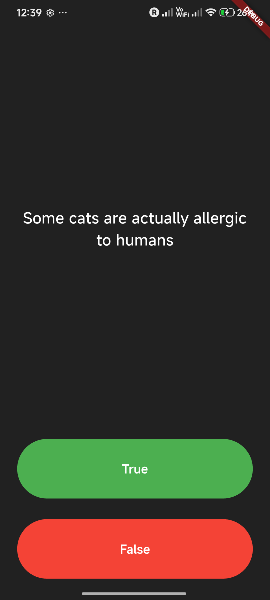
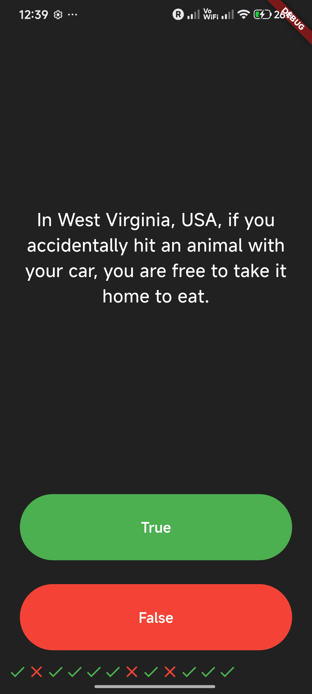
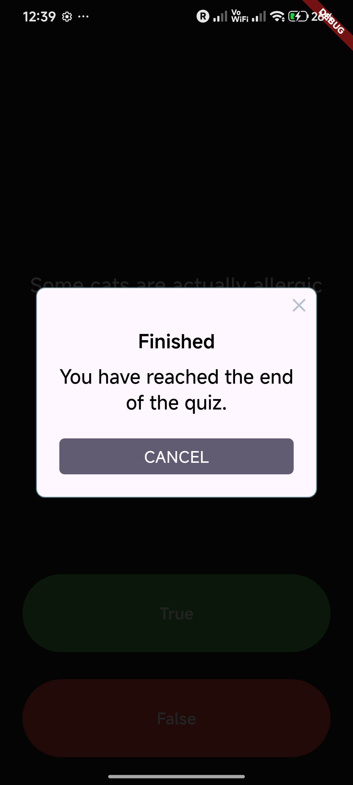

# Quizzler ❓

A True/False general knowledge quiz built with Flutter. It comes with 13 trivia questions, two answer buttons, and a little scorekeeper that tracks correct and incorrect responses as you progress.

This was my first proper exercise in organizing a Flutter application using separate classes. Instead of keeping everything inside `main.dart`, I moved the question data and quiz logic into their own files.

## 🖼️ Preview

<p align="center">
  
  
  
</p>

## 🕹️ Features

- 13 general knowledge True/False questions.
- Immediate visual feedback through green checkmarks and red crosses.
- A running scorekeeper showing the answers as you progress.
- A completion popup when the quiz reaches its final question.
- Automatic reset of the question sequence and scorekeeper for another round.

The question bank ended up being larger than the initial three questions shown in the course. I initially considered adding more questions myself, then discovered that the starter project's README already contained a much larger collection. Convenient.

## 🧱 Under the Hood

The project is divided into three main files:

| File              | Responsibility                                                       |
| ----------------- | -------------------------------------------------------------------- |
| `main.dart`       | Application UI, answer handling and scorekeeper                      |
| `question.dart`   | `Question` model containing the question text and its correct answer |
| `quiz_brain.dart` | Question bank, current question index and quiz progression logic     |

### 1. The Question Model

Each question is represented by a `Question` object with two properties:

```dart
class Question {
  final String question;
  final bool answer;

  Question(this.question, this.answer) {}
}
```

Getting this class right was a small exercise in itself. I initially tried the older constructor style from the course, but Dart's null safety made that approach unsuitable without initializing the properties appropriately.

I experimented with `late`, named required parameters and `final` fields before settling on this positional constructor. Since the question and its answer are supplied together when creating each object, this ended up being the simplest approach.

### 2. QuizBrain

`QuizBrain` handles the actual quiz logic, keeping it separate from the UI.

It maintains a private question index and provides methods to:

- Retrieve the current question and its answer.
- Move to the next question.
- Check whether the current question is the last one.
- Reset the question index for another round.

The question bank itself is stored as a list of `Question` objects. This keeps the UI from having to manage two separate lists for question text and answers, which could easily get out of sync.

### 3. UI and Answer Checking

The quiz screen is a `StatefulWidget`. It displays the current question along with True and False buttons.

When either button is pressed, `checkAnswer()` compares the user's selection with the answer returned by `QuizBrain`. A corresponding icon is added to the `scoreKeeper` list, and `setState()` triggers the UI update.

Once the quiz reaches its final question, an alert is displayed using the [`rflutter_alert`](https://pub.dev/packages/rflutter_alert) package. The question index and scorekeeper are then reset.

I also had to replace the deprecated `FlatButton` widgets from the starter code with `TextButton` and update the associated styling properties.

## 🧐 A Known Issue: The Last Question

There is a small logical issue in the current implementation, and it is intentional.

The `checkAnswer()` function checks `quizBrain.isFinished()` before evaluating the submitted answer. However, `isFinished()` returns `true` as soon as the current question index reaches the last valid index.

This means that when the user submits an answer to the 13th question, the completion popup is displayed and the quiz resets without checking that answer. Only the first 12 answers are actually recorded.

The course's TODO sequence essentially leads to this ordering, and I decided to leave it as-is rather than silently correcting it.

There are two things worth pointing out:

1. The answer-checking block could simply be moved above the completion check. That way, the final answer would be evaluated before deciding whether the quiz is over. The completion dialog could then display the number of correct answers before resetting the scorekeeper.
2. The name `isFinished()` is also semantically questionable. At that point, we are still on the last question. We haven't finished answering it yet. A method such as `isOnLastQuestion()` would describe what the current implementation actually checks. A more complete approach would distinguish being on the last question from having completed the quiz.

I have deliberately kept both issues visible in the implementation as a reminder that following a sequence of TODOs doesn't necessarily guarantee that the resulting logic is sound.

There is also an alternative ternary expression for the `isFinished()` condition retained after the `if/else` block in `quiz_brain.dart`. Since both branches already return, that expression is unreachable. It is simply another way of writing the same condition, kept there for comparison rather than as part of the active logic.

## 🧠 Concepts Practiced

- **Object-Oriented Programming:** Classes, objects, constructors, properties and methods.
- **Encapsulation:** Keeping quiz-related state and functionality inside `QuizBrain`.
- **Dart Lists:** Storing question objects and dynamically adding scorekeeper icons.
- **Null Safety:** Initializing non-nullable properties and experimenting with `late`, `final` and required parameters.
- **Private Members:** Using the underscore prefix for library-private members.
- **State Management:** Updating the question and scorekeeper through `setState()`.
- **Conditionals:** Handling answer comparison and quiz completion with `if/else`.
- **Third-party Packages:** Integrating `rflutter_alert` for the completion dialog.

## 🏃‍♂️ How To Run

Clone the repository and navigate to the project directory:

```bash
git clone https://github.com/aruncbhusal/learning-flutter.git
cd learning-flutter/day_5_1_quizzler
```

Install dependencies and run the app:

```bash
flutter pub get
flutter run
```

## 📚 References & Acknowledgements

- [Dart Lists](https://api.flutter.dev/flutter/dart-core/List-class.html)
- [Dart Classes](https://dart.dev/language/classes)
- [rflutter_alert](https://pub.dev/packages/rflutter_alert)
- [Quizzler starter repository](https://github.com/londonappbrewery/quizzler-flutter)

Built while following Angela Yu's [The Complete Flutter Development Bootcamp with Dart](https://www.udemy.com/course/flutter-bootcamp-with-dart/). The starter code was adapted to use updated Flutter widgets and the implementation was extended during the exercise.
