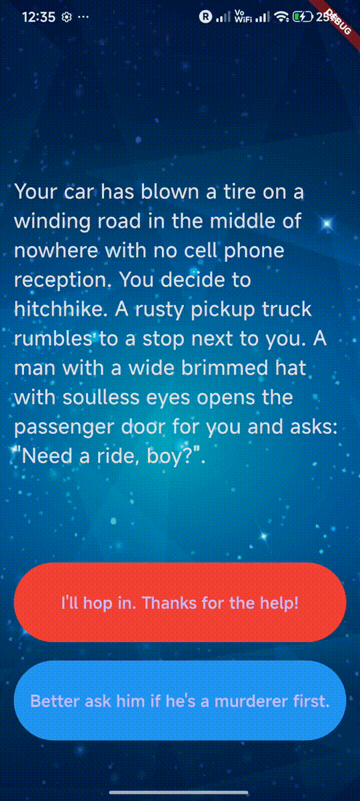

# Destini 🤔

A choose-your-own-adventure game built with Flutter. You're stranded on a remote road, a rather suspicious stranger offers you a ride, and you have to make a series of decisions that determine how the story unfolds.

There are multiple paths and three possible endings. Some decisions are more questionable than others, but that's half the fun.

## 🖼️ Preview

<p align="center">
  
</p>

## 📖 The Story

The game begins with a stranded traveller trying to hitchhike after a flat tyre. A rusty pickup stops, and its driver offers a ride. From there, the player is presented with two choices at each stage.

The decisions lead through a small branching story with three possible endings:

- **The cop-out:** Deciding to change the tyre instead of getting into the truck.
- **The crash:** Trying to stab the driver while he's behind the wheel. Probably not the best plan.
- **An unlikely friendship:** Bonding with the stranger over Elton John and suggesting the pier as a convenient place to dump bodies.

Each ending provides a `Restart` option to begin the story again.

## 🧱 How It Works

The project is split into three files:

| File               | Responsibility                                                |
| ------------------ | ------------------------------------------------------------- |
| `main.dart`        | UI, choice buttons and screen updates                         |
| `story.dart`       | `Story` model containing the story text and available choices |
| `story_brain.dart` | Story data, current position and branching logic              |

### 1. Story Model

Each story entry is represented by a `Story` object containing three properties:

```dart
class Story {
  final String storyTitle;
  final String choice1;
  final String choice2;

  Story({
    required this.storyTitle,
    required this.choice1,
    required this.choice2,
  }) {}
}
```

This keeps the story content separate from the code responsible for displaying and navigating it.

### 2. StoryBrain

`StoryBrain` maintains a list of `Story` objects and a private `_storyNumber` variable that tracks the current position.

It provides methods to retrieve the current story and its choices, process the player's selection, restart the story and determine whether the second choice should be displayed.

The branching itself is handled through conditional logic inside `nextStory()`. Depending on the current story and the selected choice, `_storyNumber` is updated to point to another entry in the list.

The story has six entries in total: three decision-making stages and three endings.

### 3. UI and Navigation

`StoryPage` is a `StatefulWidget` that displays the current story and its choices. Whenever a choice is selected, `setState()` calls `storyBrain.nextStory()` and updates the screen with the next part of the story.

The second choice is wrapped inside a `Visibility` widget. Its visibility is controlled by `buttonShouldBeVisible()` in `StoryBrain`, which hides it when an ending is reached. At that point, only the `Restart` option remains.

The screen also uses a background image through `BoxDecoration` and `DecorationImage`, with `BoxFit.cover` to fill the available space. The two choices use differently coloured `TextButton` widgets.

## 🧠 What I Took Away

This challenge builds on the OOP concepts introduced in Quizzler, particularly using separate classes to organize data and application logic.

A few concepts put into practice:

- **Classes and Objects:** Representing individual story entries using a custom `Story` class.
- **Encapsulation:** Keeping the story list and current index private within `StoryBrain`.
- **Lists:** Storing the story sequence and accessing entries by index.
- **Conditional Logic:** Routing the player through different branches based on their choices.
- **State Management:** Updating the screen using `setState()` after each decision.
- **Visibility:** Dynamically showing or hiding UI elements based on the current story state.
- **Background Images:** Using `BoxDecoration`, `DecorationImage` and `BoxFit.cover` to style the screen.

I approached this as a challenge rather than following the instructions line by line. The provided TODOs were sufficient to guide the implementation, and I was able to work through the required functionality using what I'd learned from the previous projects.

## 🏃‍♂️ How To Run

Clone the repository and navigate to the project directory:

```bash
git clone https://github.com/aruncbhusal/learning-flutter.git
cd learning-flutter/day_5_2_destini
```

Install dependencies and run the app:

```bash
flutter pub get
flutter run
```

## 📚 References & Acknowledgements

- [Story starter repository](https://github.com/londonappbrewery/destini-challenge-starting)
- [Visibility widget](https://api.flutter.dev/flutter/widgets/Visibility-class.html)
- [BoxDecoration](https://api.flutter.dev/flutter/painting/BoxDecoration-class.html)
- [DecorationImage](https://api.flutter.dev/flutter/painting/DecorationImage-class.html)

Built while following Angela Yu's [The Complete Flutter Development Bootcamp with Dart](https://www.udemy.com/course/flutter-bootcamp-with-dart/). The starter project and assets were adapted while completing the challenge.

More detailed learning notes are available in [`notes.md`](../notes.md#day-5).
