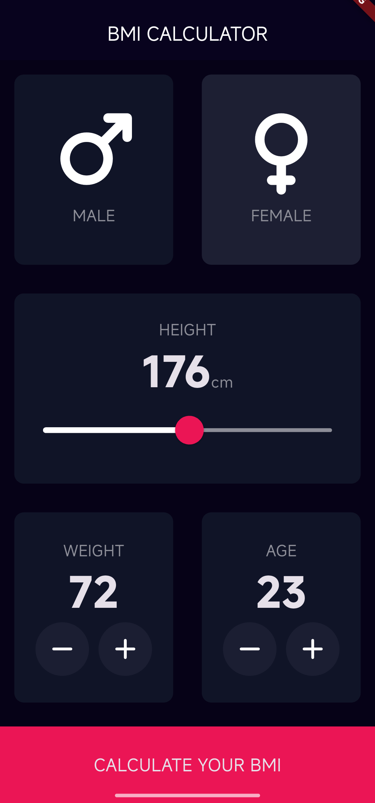
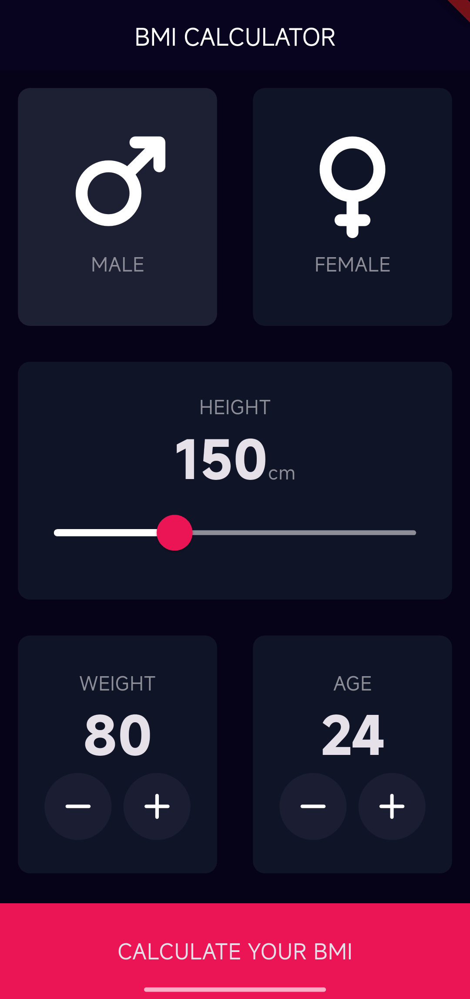
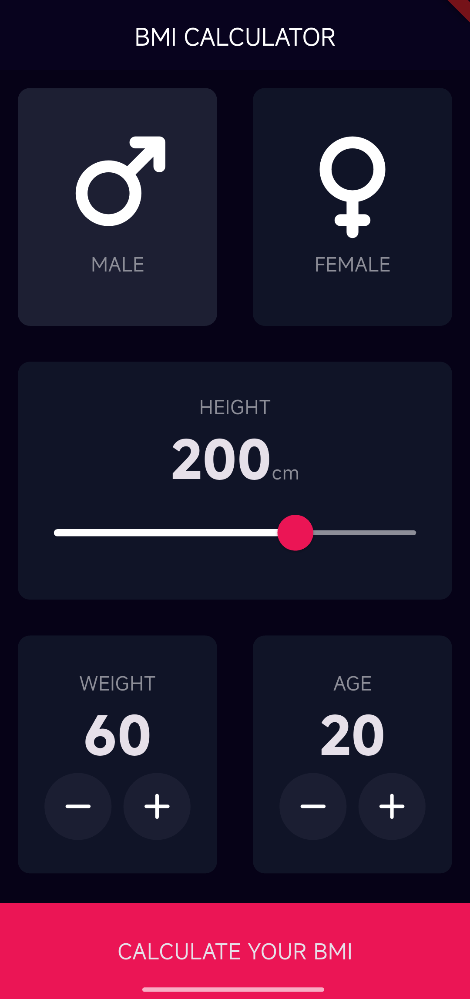
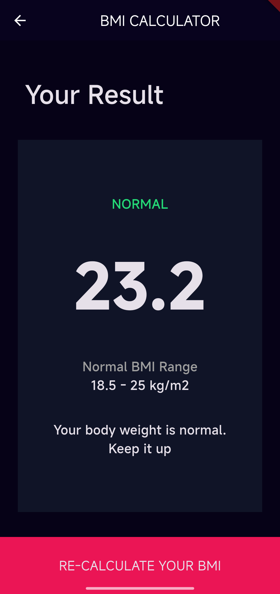
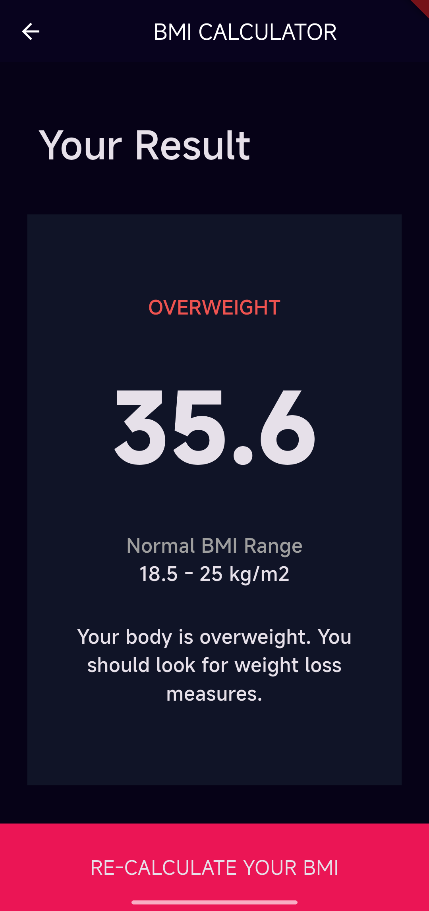
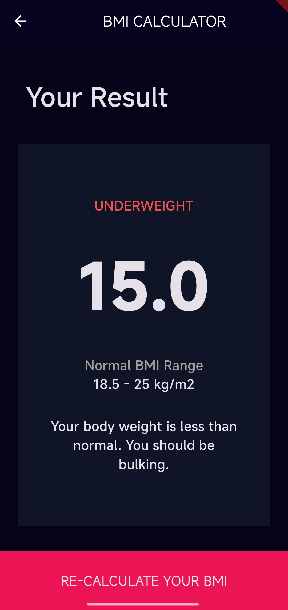

# BMI Calculator 💪

A Body Mass Index calculator built with Flutter, inspired by [Ruben Vaalt's design on Dribbble](https://dribbble.com/shots/4585382-Simple-BMI-Calculator).

This project focuses heavily on UI customization and introduces a few more involved Flutter concepts, including themes, reusable widgets, custom components and navigation between screens.

## 🖼️ Preview

### Input Screen

<p align="center">
  
  
  
</p>

### Results Screen

<p align="center">
  
  
  
</p>

## 🕹️ Features

The app has two screens: an input screen where the user provides their details, followed by a results screen displaying the calculated BMI.

The input screen includes:

- **Gender selection:** Select between male and female, with the selected card highlighted.
- **Height slider:** Adjust height between 100 and 250 cm.
- **Weight selector:** Increase or decrease weight using round buttons.
- **Age selector:** Similarly, adjust age using increment and decrement buttons.
- **BMI calculation:** Pass the selected height and weight to the calculation logic and navigate to the results screen.

The results screen displays the calculated BMI, its corresponding category, a colour-coded indicator and a short remark. There's also a button to return to the input screen and recalculate.

## 🧮 The Calculation

The actual BMI calculation is handled separately in `CalculatorBrain`, rather than being mixed into the UI code.

The formula used is:

$$
BMI = \frac{Weight\ (kg)}{Height\ (m)^2}
$$

Since the height is collected in centimetres, the implementation converts the squared height to square metres:

```dart
double bmi = weight / (height * height / 10000);
```

The calculator then returns a map containing:

- The calculated BMI, formatted to one decimal place.
- A category (`UNDERWEIGHT`, `NORMAL` or `OVERWEIGHT`).
- A colour associated with the category.
- A short remark based on the result.

The results page receives this information and uses it to populate the UI.

## 🧱 Structure & Reusable Components

I tried to keep the project modular by separating screen-specific functionality, reusable UI components and shared styling constants.

```text
lib/
├── components/
│   ├── bottom_button.dart
│   ├── icon_content.dart
│   ├── reusable_card.dart
│   └── round_button.dart
├── screens/
│   ├── calculator_brain.dart
│   ├── input_page.dart
│   └── results_page.dart
├── constants.dart
└── main.dart
```

A few of the components worth mentioning:

- **ReusableCard:** A common card container with configurable colour, child widget and optional tap callback.
- **IconContent:** Displays an icon alongside its label, used for gender selection.
- **RoundButton:** A reusable circular button used for the weight and age controls.
- **BottomButton:** The wide action button used to calculate and recalculate BMI.

The shared colours, dimensions and text styles are consolidated in `constants.dart`, rather than being scattered across individual widgets.

The project also uses `font_awesome_flutter` for the gender and increment/decrement icons.

## 🎨 UI, Themes & Navigation

The app uses Flutter's dark theme as a starting point, with custom background and app bar colours defined through `ThemeData.dark().copyWith()`.

The input screen is composed using nested `Row` and `Column` widgets, with `Expanded` to distribute available space. The cards themselves are built using `Container` and `BoxDecoration`, with rounded corners to achieve the desired appearance.

The height selector uses a `Slider` with a customized `SliderTheme`. This allows the track, thumb and overlay to match the rest of the colour palette.

For navigation, the Calculate button uses `Navigator.push()` with a `MaterialPageRoute` to open `ResultsPage`. The recalculation button uses `Navigator.pop()` to return to the previous screen.

### A Small Layout Detour

I initially attempted the results screen independently before comparing it with the course implementation. That didn't go entirely smoothly: I ran into a `RenderFlex` overflow when trying to fit everything into the available vertical space.

The course solution used `Expanded` with a larger `flex` for the result card, which allocates more of the available space to the main content. I incorporated that approach to resolve the layout issue.

It's a good example of why simply placing widgets inside a `Column` doesn't guarantee that they'll fit. Constraints and available space matter.

## 🧠 Concepts Practiced

- **Flutter Themes:** Using `ThemeData` and `copyWith()` to maintain a consistent design.
- **Custom UI Components:** Extracting reusable widgets and composing them to build the interface.
- **Enums:** Representing gender selection using a `Gender` enum.
- **GestureDetector:** Handling taps on custom cards and buttons.
- **Sliders:** Customizing the appearance and behaviour of the height selector.
- **Navigation:** Using `Navigator.push()` and `Navigator.pop()` to move between screens.
- **Dart Functions:** Passing callbacks as parameters to reusable widgets.
- **Ternary Operators:** Simplifying conditional styling and result categorization.
- **Constants:** Centralizing shared styles, colours and dimensions.

## ⚠️ Notes & Limitations

This is a learning project, not a medical tool. The BMI categories and remarks are based on simple thresholds in the implementation and should not be treated as a diagnosis or personalized health assessment.

Gender and age are currently collected by the UI but are not used in the BMI calculation, which relies only on height and weight.

## 🏃‍♂️ How To Run

Clone the repository and navigate to the project directory:

```bash
git clone https://github.com/aruncbhusal/learning-flutter.git
cd learning-flutter/day_5_3_bmi_calculator
```

Install dependencies and run the app:

```bash
flutter pub get
flutter run
```

## 📚 References & Acknowledgements

- [Original BMI Calculator design by Ruben Vaalt](https://dribbble.com/shots/4585382-Simple-BMI-Calculator)
- [Flutter Themes](https://docs.flutter.dev/cookbook/design/themes)
- [Slider](https://api.flutter.dev/flutter/material/Slider-class.html)
- [GestureDetector](https://api.flutter.dev/flutter/widgets/GestureDetector-class.html)
- [Navigator](https://api.flutter.dev/flutter/widgets/Navigator-class.html)
- [Font Awesome Flutter](https://pub.dev/packages/font_awesome_flutter)
- [BMI Calculator starter repository](https://github.com/londonappbrewery/bmi-calculator-flutter)

Built while following Angela Yu's [The Complete Flutter Development Bootcamp with Dart](https://www.udemy.com/course/flutter-bootcamp-with-dart/). The starter project was adapted and extended while following the course.
