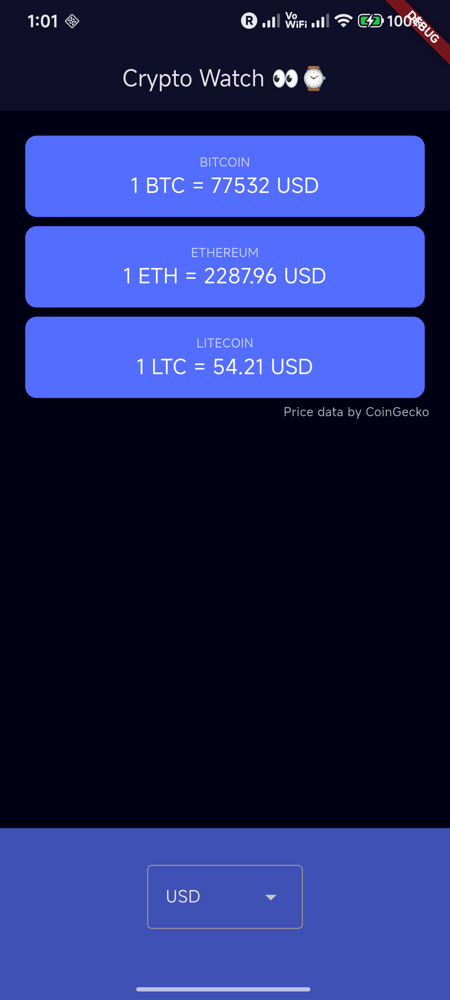
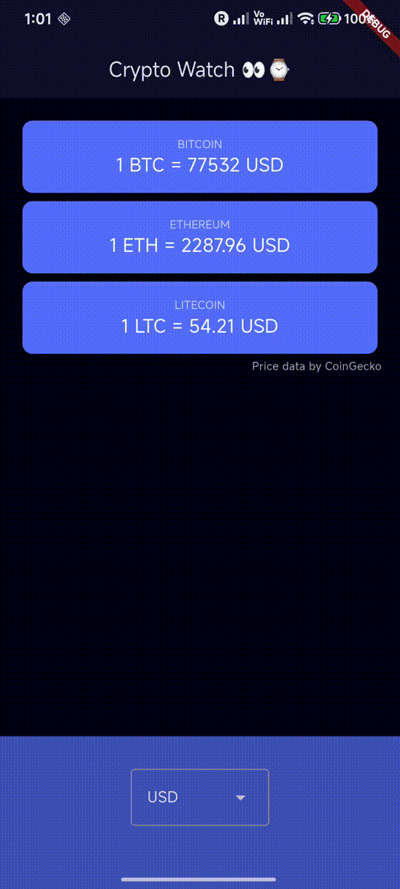

# Crypto Ticker 🪙

A cryptocurrency price tracker built with Flutter. It displays the exchange rates of Bitcoin, Ethereum, and Litecoin against a selectable list of fiat currencies.

The project started as a course challenge, but I ended up adapting the API integration and using different currency selectors for Android and iOS.

## Preview

<p align="center" style="display: flex; flex-direction: row; justify-content: space-around;">
  
  
</p>

## Features

- View the exchange rates of **BTC, ETH, and LTC**.
- Choose from 21 supported fiat currencies, including USD, EUR, GBP, INR, and AUD.
- Use a Material 3 dropdown menu on Android and a Cupertino picker on iOS.
- Fetch all three cryptocurrency rates in a single API request.
- Display the selected currency alongside each rate.

The selected fiat currency defaults to AUD. Rates are fetched when the app starts and whenever the selected currency changes. This is a simple price lookup app, not a continuously refreshing live ticker.

## How It Works

The app uses the [CoinGecko Simple Price API](https://docs.coingecko.com/reference/simple-price) to retrieve exchange rates.

CoinGecko identifies cryptocurrencies using IDs rather than ticker symbols, so I maintain a small mapping between the symbols used in the UI and their corresponding API IDs:

| Symbol | CoinGecko ID |
| ------ | ------------ |
| BTC    | `bitcoin`    |
| ETH    | `ethereum`   |
| LTC    | `litecoin`   |

When the app starts, `initState()` initializes the displayed rates and calls `getData()`. The `CoinData` class then sends a GET request to the `/simple/price` endpoint with the three coin IDs and the selected fiat currency.

Instead of making three separate requests, the app joins the coin IDs into a comma-separated string and retrieves all three rates together. The response is decoded from JSON and mapped back to the cryptocurrency symbols used by the UI.

Changing the selected currency triggers another request using the new currency code.

## Platform-Specific Currency Selection

The app uses `Platform.isIOS` from `dart:io` to decide which selector to display.

- **Android:** Material 3 `DropdownMenu`, populated with `DropdownMenuEntry` objects.
- **iOS:** `CupertinoPicker`, populated with the available currency codes.

I used `DropdownMenu` instead of the course's `DropdownButton`. The newer widget has a different API, using `dropdownMenuEntries`, `onSelected`, and `initialSelection`.

Both selectors update the same `selectedCurrency` state variable, so the rest of the app does not need to know which picker is being used.

## Project Structure

```text
lib/
├── main.dart
├── price_screen.dart
└── coin_data.dart
```

| File                | Responsibility                                                                  |
| ------------------- | ------------------------------------------------------------------------------- |
| `main.dart`         | App entry point, MaterialApp configuration, and dark theme.                     |
| `price_screen.dart` | Main screen, cryptocurrency cards, currency selection, and UI state.            |
| `coin_data.dart`    | Supported currencies and cryptocurrencies, API requests, and response handling. |

## Concepts Practiced

- **HTTP requests and JSON:** Sending GET requests using the `http` package and decoding API responses with `jsonDecode`.
- **Asynchronous programming:** Using `Future`, `async`, and `await` to handle network requests.
- **Dart collections and loops:** Working with lists and maps, iterating through currencies and cryptocurrencies, and building widgets dynamically.
- **Widget lifecycle:** Using `initState()` to initialize data when the screen is created.
- **State management:** Updating displayed exchange rates and the selected currency using `setState()`.
- **Platform-specific UI:** Using `Platform.isIOS` to choose between Material and Cupertino widgets.
- **Material 3 and Cupertino widgets:** Working with `DropdownMenu`, `DropdownMenuEntry`, and `CupertinoPicker`.

## API and Dependencies

This project uses:

- [Flutter](https://flutter.dev/)
- [`http`](https://pub.dev/packages/http) for network requests.
- [CoinGecko API](https://www.coingecko.com/en/api) for cryptocurrency exchange rates.

The current implementation calls CoinGecko's `/api/v3/simple/price` endpoint without an API key. API access requirements can change, so check the current [CoinGecko authentication documentation](https://docs.coingecko.com/reference/authentication) if requests are rejected. A Demo API key may be required; the request can then be updated to include the `x-cg-demo-api-key` header.

## Notes and Limitations

- The app fetches prices on startup and when the selected currency changes. It does not refresh prices periodically.
- API error handling is basic. Exceptions are printed to the console, and the code assigns `N/A` as a fallback rate. However, the error branch currently does not call `setState()`, so that fallback may not be reflected immediately in the UI.
- The app supports only the three cryptocurrencies and 21 fiat currencies defined in `coin_data.dart`.

## Running the Project

Clone the repository and navigate to the project directory:

```bash
git clone https://github.com/aruncbhusal/learning-flutter.git
cd learning-flutter/day_7_crypto_ticker
```

Install dependencies and run the app:

```bash
flutter pub get
flutter run
```

An internet connection is required to retrieve exchange rates.

## Acknowledgements

This project is part of [The Complete Flutter Development Bootcamp](https://www.appbrewery.co/). The initial project structure and learning material were provided by The App Brewery; the API integration and platform-specific implementation were adapted while completing the challenge.
