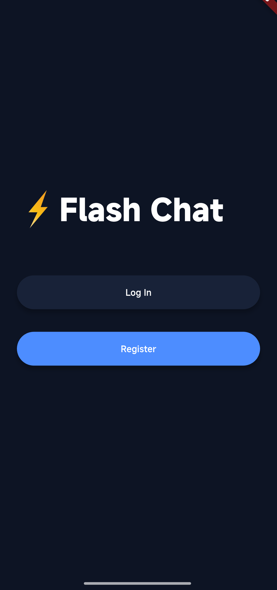
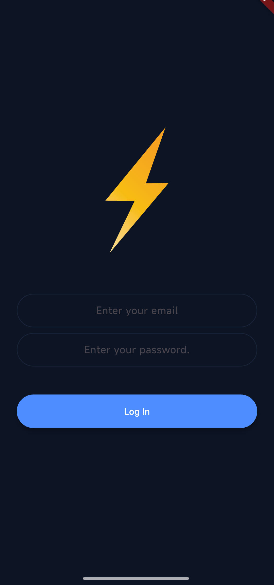
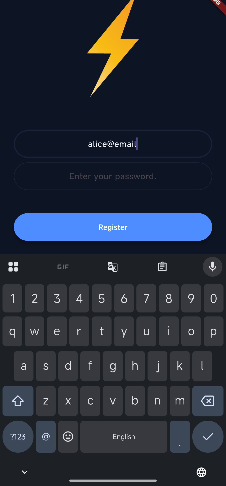
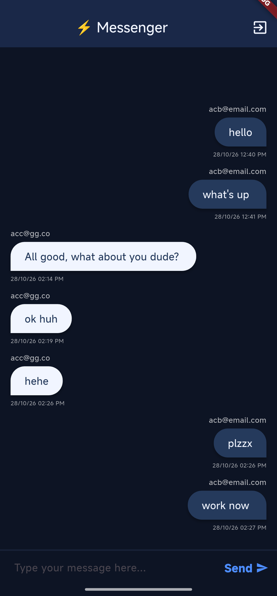
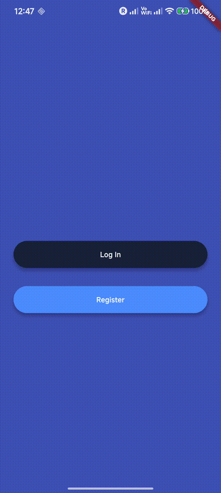

# Flash Chat ⚡

A real-time messaging app built with Flutter and Firebase. Users can register or log in with an email and password, then exchange messages in a shared chat room.

This project was my introduction to Firebase integration in Flutter, covering authentication, cloud data storage, and real-time updates. I also worked with Flutter's animation system to build the welcome screen.

## Preview

<p align="center">
  
  
  
</p>

<p align="center">
  
</p>

<p align="center">
  
</p>

## Features

- Register new users and log in with email and password using Firebase Authentication.
- Send messages to a shared chat room.
- Store messages in Cloud Firestore.
- Receive new messages in real time using Firestore streams.
- Distinguish between messages sent by the current user and messages from other users.
- Display message timestamps, with different formats for today's messages and older ones.
- Animated welcome screen with a shared logo transition between screens.

## How It Works

### Authentication

The app uses Firebase Authentication with the email/password provider.

Users can create an account from the registration screen or sign in using an existing account. Firebase handles the authentication process, while the app catches authentication errors and displays them using SnackBars.

After successful authentication, the user is navigated to the chat screen. Logging out signs the user out through Firebase Authentication and returns them to the previous screen.

A modal progress indicator is also included for asynchronous authentication operations.

### Sending Messages

Messages are stored in a Firestore collection named `messages`. Each document contains three fields:

| Field    | Description                                     |
| -------- | ----------------------------------------------- |
| `text`   | The message content.                            |
| `sender` | Email address of the user who sent the message. |
| `sentAt` | Server-generated timestamp.                     |

When the user sends a message, the app adds a new document to the collection using the `add()` method. Empty messages are ignored, and the input field is cleared after a successful send.

### Receiving Messages in Real Time

Rather than periodically polling Firestore for new messages, the app subscribes to the collection's `snapshots()` stream.

A `StreamBuilder` listens to this stream and rebuilds the message list whenever the underlying data changes. This allows messages sent by other users to appear without manually refreshing the screen.

Messages are ordered by their timestamp and displayed in a reversed `ListView`, keeping the most recent messages at the bottom.

### Message Bubbles

Each message is displayed using a custom `MessageBubble` widget.

The app compares the sender's email with the currently logged-in user's email to determine whether a message belongs to the current user.

- Messages sent by the current user are aligned to the right.
- Messages from other users are aligned to the left.
- Each message displays its sender and timestamp.

The `intl` package is used to format timestamps. Messages sent today display only the time, while older messages also include the date.

## Animations and Navigation

The welcome screen uses a combination of Flutter's built-in animation system and the `animated_text_kit` package.

- **AnimationController and ColorTween:** Animate the background from indigo to a darker shade.
- **AnimatedTextKit:** Displays the app title using a typewriter effect.
- **Hero:** Creates a shared-element transition for the logo when navigating to the login or registration screens.
- **SingleTickerProviderStateMixin:** Supplies the ticker required by the animation controller.

The app also uses named routes with static route identifiers for navigation between the welcome, login, registration, and chat screens.

## Project Structure

```text
lib/
├── components/
│   └── rounded_button.dart
├── screens/
│   ├── chat_screen.dart
│   ├── login_screen.dart
│   ├── registration_screen.dart
│   └── welcome_screen.dart
├── constants.dart
├── firebase_options.dart
└── main.dart
```

| File                       | Responsibility                                                                |
| -------------------------- | ----------------------------------------------------------------------------- |
| `main.dart`                | Initializes Firebase and defines the app's named routes.                      |
| `welcome_screen.dart`      | Welcome screen, animations, and navigation to authentication screens.         |
| `login_screen.dart`        | Existing-user authentication.                                                 |
| `registration_screen.dart` | New-user registration.                                                        |
| `chat_screen.dart`         | Message composition, Firestore integration, message stream, and chat bubbles. |
| `rounded_button.dart`      | Reusable rounded button component.                                            |
| `constants.dart`           | Shared styling for text fields, message input, and send button.               |
| `firebase_options.dart`    | Platform-specific Firebase configuration generated by FlutterFire CLI.        |

## Concepts Practiced

- **Firebase integration:** Initializing Firebase and connecting Flutter to Firebase services.
- **Authentication:** Registering, signing in, retrieving the current user, and signing out with Firebase Authentication.
- **Cloud Firestore:** Adding documents to a collection and retrieving data from the database.
- **Streams and asynchronous programming:** Understanding `Future`, `Stream`, `async`, and `await`, and how they differ.
- **StreamBuilder:** Turning a continuously updating data stream into a Flutter widget.
- **Animations:** Working with `AnimationController`, `Animation`, `Tween`, `Hero`, and mixins.
- **Navigation:** Using named routes and static identifiers.
- **Scrollable layouts:** Using `ListView` for a dynamically updated message list.
- **Reusable components:** Extracting common button styling into a separate widget.
- **Date and time formatting:** Formatting Firestore timestamps using the `intl` package.

## Firebase Setup

This project requires its own Firebase configuration. No Firebase project configuration is included in this repository.

To connect the application to your Firebase project:

1. Create a Firebase project.
2. Install the [Firebase CLI](https://firebase.google.com/docs/cli) and log in.
3. Activate the FlutterFire CLI:

    ```bash
    dart pub global activate flutterfire_cli
    ```

4. From the root directory of your newly created Flutter project, run:

    ```bash
    flutterfire configure
    ```

   Select the platforms you intend to use. FlutterFire generates the corresponding configuration, including `lib/firebase_options.dart`.

5. In the Firebase Console, enable **Email/Password** under Authentication sign-in providers.
6. Create a Cloud Firestore database.

The app creates the `messages` collection automatically when the first message is sent.

**Firestore security rules must also be configured.** The application expects authenticated users to be able to read and write messages. Do not deploy an unrestricted test-mode database.

Useful documentation:

- [Firebase setup for Flutter](https://firebase.google.com/docs/flutter/setup)
- [Email and password authentication](https://firebase.google.com/docs/auth/flutter/password-auth)
- [Cloud Firestore security rules](https://firebase.google.com/docs/firestore/security/get-started)

## Dependencies

| Package                  | Purpose                                                 |
| ------------------------ | ------------------------------------------------------- |
| `firebase_core`          | Firebase initialization.                                |
| `firebase_auth`          | User authentication.                                    |
| `cloud_firestore`        | Cloud database and real-time message streams.           |
| `animated_text_kit`      | Typewriter text animation.                              |
| `modal_progress_hud_nsn` | Modal loading indicator during asynchronous operations. |
| `intl`                   | Message timestamp formatting.                           |

## ♻️ Reusing This Project

This directory contains the application's Dart source code and required assets. The platform-specific project scaffolding has intentionally been omitted to keep this repository focused on the application itself.

To use this project, create a fresh Flutter application and copy the relevant source files and resources into it.

### 1. Clone the repository

```bash
git clone https://github.com/aruncbhusal/learning-flutter.git
```

### 2. Create a new Flutter project

Navigate to the cloned repository and create a new Flutter application outside it:

```bash
cd learning-flutter
flutter create --project-name flash_chat ../flash_chat
```

Use the package name specified by the `name` field in this project's `pubspec.yaml`. This keeps the existing `package:` imports valid without having to rename them manually.

### 3. Copy the source code and assets

Copy the contents of this project's `lib/` directory into the newly created application's `lib/` directory.

Also copy any project-specific resource directories present in this folder, such as:

- `images/`
- `assets/`
- `fonts/`

Keep their directory names and relative paths unchanged, since the application may refer to them through its asset declarations.

The new project's generated `lib/main.dart` will be replaced by this project's entry point. Its platform-specific folders and configuration should otherwise remain intact.

### 4. Merge dependencies and asset declarations

Open this project's `pubspec.yaml` and add the required entries to the corresponding sections of the new application's `pubspec.yaml`.

In particular:

- Add the required packages from `dependencies`.
- Add any required development packages from `dev_dependencies`, if needed.
- Merge the asset and font declarations under `flutter`.

Do not replace the newly generated `pubspec.yaml` wholesale. Retain its project name, Dart SDK constraints, Flutter SDK dependency and other generated configuration.

Do not copy this project's `pubspec.lock`. The new application should resolve its own dependencies.

### 5. Configure and run

Complete any additional setup described in this README, such as API keys, platform permissions or Firebase configuration.

Then navigate to the newly created application and run:

```bash
flutter pub get
flutter run
```

A connected device or configured emulator is required.

**Note:** These project directories are source templates, not standalone Flutter applications. They are intended to be used as a starting point for a new project rather than run directly from this repository.

A working Firebase configuration and an internet connection are required.

## Notes and Limitations

- This is a single shared chat room. There are no private conversations, user-specific rooms, or group management features.
- Messages are stored with the sender's email address. There is no separate user profile or display-name system.
- The app does not currently implement message editing, deletion, attachments, push notifications, or pagination.
- Firebase configuration is currently set up for Android and iOS. Other platforms need their own Firebase configuration.
- Firestore access depends on the security rules configured in the Firebase project.
