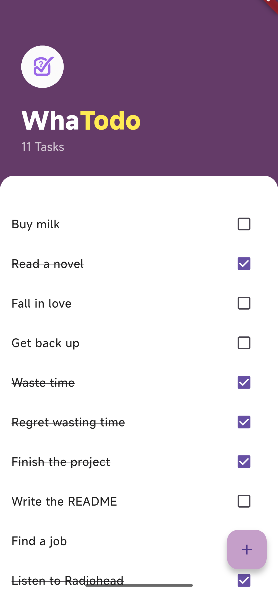
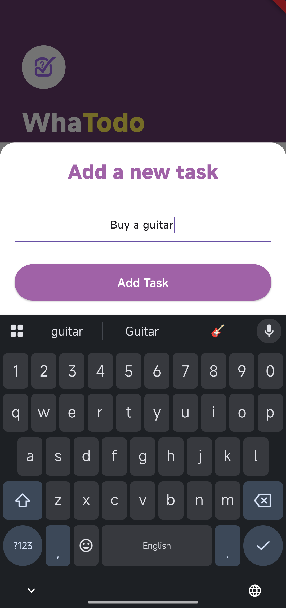
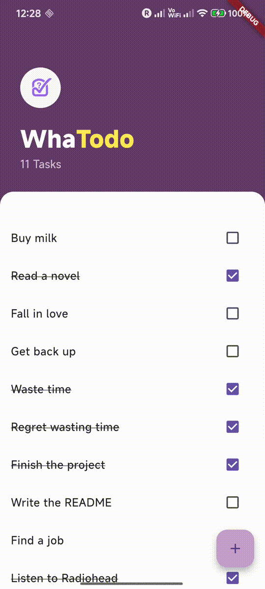

# WhaTodo ✅

A simple task management app built with Flutter. Add tasks, mark them as completed, and remove them when they're no longer needed.

This project was built from scratch, following the concepts introduced in the course rather than copying its implementation. I initially considered the name Todoey, but that didn't quite feel right, so WhaTodo it is.

## Preview

<p align="center">
  
  
</p>

<p align="center">
  
</p>

## Features

- Add tasks through a modal bottom sheet.
- Mark tasks as completed using checkboxes.
- Completed tasks are displayed with a strikethrough.
- Remove tasks by long-pressing them.
- Automatically update the task count as tasks are added or removed.
- Responsive task list using `ListView.builder`.

## How It Works

### Task Model

Each task is represented by a simple `Task` class with two properties:

- `title`: The task description, which is immutable.
- `isDone`: A boolean indicating whether the task has been completed. It defaults to `false`.

The class also provides a `toggleDone()` method to switch the completion state.

### Managing the Task List

The `AllTasks` class extends Flutter's `ChangeNotifier` and holds the list of tasks.

It provides methods to:
- Add a task.
- Toggle a task's completion status.
- Remove a task by index.

Whenever the list changes, `notifyListeners()` informs its listeners so that the relevant parts of the UI can rebuild.

The task list is exposed through an `UnmodifiableListView`, preventing callers from directly modifying the list while still allowing them to access individual task objects.

### State Management with Provider

The app uses the [Provider](https://pub.dev/packages/provider) package to make the `AllTasks` instance available throughout the widget tree.

A `ChangeNotifierProvider` is initialized above the `MaterialApp`, allowing both the main screen and the modal bottom sheet to access the same task data.

Instead of making the entire screen rebuild whenever a task changes, I use `Consumer` widgets to limit updates to the portions that depend on the task list, such as the task count and the list itself.

The add-task modal uses `context.read()` to access the provider without subscribing to changes, since it only needs to add a task rather than display the updated list.

### Adding and Removing Tasks

The floating action button opens a modal bottom sheet containing a text field and an Add Task button.

The sheet uses `isScrollControlled` and adjusts its bottom padding according to the keyboard's view insets. This keeps the input and button accessible when the keyboard is open.

Empty task titles are ignored, and whitespace around a valid title is trimmed before adding it.

Tasks can be removed by long-pressing their tiles.

## Project Structure

```text
lib/
├── models/
│   ├── all_tasks.dart
│   └── task.dart
├── screens/
│   ├── add_task_modal.dart
│   └── tasks_screen.dart
├── widgets/
│   ├── task_list.dart
│   └── task_tile.dart
├── constants.dart
└── main.dart
```

| File | Responsibility |
|---|---|
| `main.dart` | App entry point and Provider initialization. |
| `task.dart` | Individual task model. |
| `all_tasks.dart` | Task collection and state-change notifications. |
| `tasks_screen.dart` | Main screen, task count, and modal-sheet navigation. |
| `add_task_modal.dart` | Task input and submission. |
| `task_list.dart` | Builds the task list from Provider data. |
| `task_tile.dart` | Displays an individual task and handles its interactions. |
| `constants.dart` | Shared color palette and text styles. |

## Concepts Practiced

- **State management:** Understanding local state, lifting state up, and managing shared state with Provider.
- **ChangeNotifier:** Creating a model that notifies listeners whenever its data changes.
- **Provider:** Using `ChangeNotifierProvider`, `Consumer`, `context.read()`, and shared state across widgets.
- **Widget composition:** Separating the task model, list, individual task tile, and input modal into reusable components.
- **Callbacks:** Passing functions from parent widgets to child widgets to handle checkbox changes and deletion.
- **Scrollable lists:** Using `ListView.builder` to build task tiles dynamically.
- **Modal bottom sheets:** Using `showModalBottomSheet`, keyboard insets, and scroll-controlled layouts.
- **Dart collections:** Working with `List`, `UnmodifiableListView`, and custom model objects.

## Dependencies

- [Flutter](https://flutter.dev/)
- [`provider`](https://pub.dev/packages/provider) for state management.

## ♻️ Reusing This Project

This directory contains the application's Dart source code and required assets. The platform-specific project scaffolding has intentionally been omitted to keep this repository focused on the application itself.

To use this project, create a fresh Flutter application and copy the relevant source files and resources into it.

### 1. Clone the repository

```bash
git clone https://github.com/aruncbhusal/learning-flutter.git
```

### 2. Create a new Flutter project

Navigate to the cloned repository and create a new Flutter application outside it:

```bash
cd learning-flutter
flutter create --project-name whatodo ../whatodo
```

Use the package name specified by the `name` field in this project's `pubspec.yaml`. This keeps the existing `package:` imports valid without having to rename them manually.

### 3. Copy the source code and assets

Copy the contents of this project's `lib/` directory into the newly created application's `lib/` directory.

Also copy any project-specific resource directories present in this folder, such as:

- `images/`
- `assets/`
- `fonts/`

Keep their directory names and relative paths unchanged, since the application may refer to them through its asset declarations.

The new project's generated `lib/main.dart` will be replaced by this project's entry point. Its platform-specific folders and configuration should otherwise remain intact.

### 4. Merge dependencies and asset declarations

Open this project's `pubspec.yaml` and add the required entries to the corresponding sections of the new application's `pubspec.yaml`.

In particular:

- Add the required packages from `dependencies`.
- Add any required development packages from `dev_dependencies`, if needed.
- Merge the asset and font declarations under `flutter`.

Do not replace the newly generated `pubspec.yaml` wholesale. Retain its project name, Dart SDK constraints, Flutter SDK dependency and other generated configuration.

Do not copy this project's `pubspec.lock`. The new application should resolve its own dependencies.

### 5. Configure and run

Complete any additional setup described in this README, such as API keys, platform permissions or Firebase configuration.

Then navigate to the newly created application and run:

```bash
flutter pub get
flutter run
```

A connected device or configured emulator is required.

**Note:** These project directories are source templates, not standalone Flutter applications. They are intended to be used as a starting point for a new project rather than run directly from this repository.

## Notes and Limitations

- Tasks are stored only in memory through Provider. They are lost when the app is closed or restarted.
- There is no task editing, categorization, scheduling, or persistent storage.
- Deleting a task currently happens immediately on long press, without a confirmation dialog.

This project focuses on Flutter UI composition and state management rather than building a fully featured productivity application.